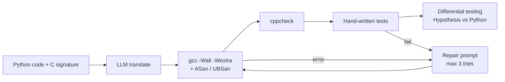
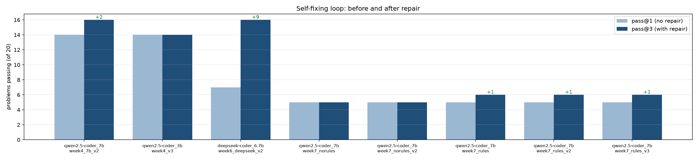
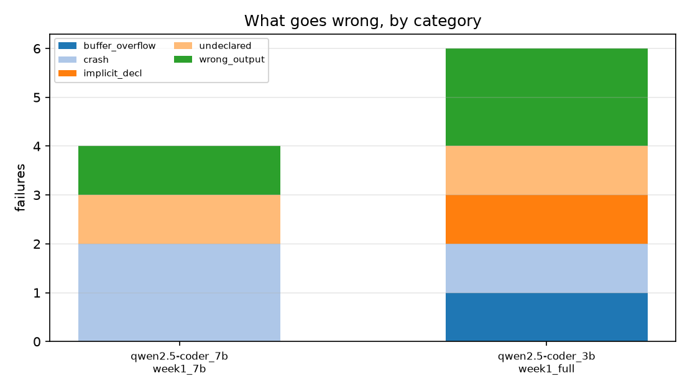

<h1 align="center">🔄 LLM Code Migration: Python → C</h1>

<p align="center">
  <b>Translate Python into C with an LLM, then prove the result actually works.</b>
</p>

<p align="center">
  
  
  
  
</p>

---

## 📌 Why this project

Most research on LLM code translation targets Java, C++, Go, or C → Rust. **Python → C is barely studied**, even though it is the hardest pair:

- C has no lists, dicts, classes, exceptions, or generators
- C needs manual memory management (`malloc`, `free`, buffer sizes)
- Python integers never overflow; C integers do

So "it compiles" means very little. This tool translates Python to C and then **checks the output in four layers**: compiler, static analysis, sanitizers, and differential testing against the original Python.

## 🔁 Pipeline



All compiling and running of generated code happens inside a **Docker sandbox**.

## 📊 Key results

30 problems: 20 core functions, 7 "hard feature" problems, 3 multi-function files. All models run locally through Ollama.

**Model comparison (20 problems, repair loop, 3 attempts)**

| Model | Pass on 1st try | Pass after repair | Problems repaired |
|---|---|---|---|
| qwen2.5-coder:3b | 14/20 | 14/20 | 0 |
| qwen2.5-coder:7b | 14/20 | 16/20 | 2 |
| deepseek-coder:6.7b | 7/20 | **16/20** | **9** |

**Main findings**

1. **First-try quality and repair ability are different skills.** deepseek translates worst at first but repairs 9 problems. Ranking models on first-try pass rate alone picks the wrong one.
2. **Prompt quality beat model size.** One header rule raised the compile rate from 75% to 100%. Moving from 3b to 7b gained nothing on single-shot runs.
3. **Compiling is not verifying.** Some failures were invisible to the compiler and cppcheck and only showed up at runtime (buffer overflow, segfault, wrong output).
4. **Differential testing found bugs that every hand-written test missed:**
   - `fib(93)` overflows `long long` (Python ints are unbounded). All models.
   - `fib(-1)` hangs forever (negative number cast to `size_t`). All models.
   - Heap buffer overflow and segfault on 2-character strings.
   - `str.capitalize()` semantics lost (`"0A"` → `"0A"` instead of `"0a"`).
5. **Repair has a capability threshold.** 3b fixed nothing, even when gcc suggested the exact fix.
6. **Hard features:** classes, generators, `None` returns, and comprehensions translated on the first try. Default arguments failed in every setup because of a `malloc` off-by-one the model could not see, even with the sanitizer report.

<p align="center">
  
  
</p>

Full write-ups for each stage are in [`results/`](results/) (`week1.md` … `week7.md`, `comparison.md`).

## ✨ Features

- **Any model** via [LiteLLM](https://github.com/BerriAI/litellm): local Ollama (free), OpenAI, or Anthropic
- **Fixed C signatures** so tests can always call the translated function
- **C mapping rules** in the prompt: lists → pointer + length, returned arrays → `malloc` + `out_len`, exceptions → status codes
- **Multi-function files**: Tree-sitter parsing, dependency ordering, and a C assembler that merges includes and prototypes
- **Self-repair loop** with its own prompt; compiler and sanitizer errors are fed back
- **Error classifier** that sorts failures into types (undeclared, buffer overflow, crash, wrong output, …)
- **Differential testing** with Hypothesis; C signatures are parsed automatically to build the harness
- **Docker sandbox** for safe execution of generated code
- **Streamlit UI** to try it on your own code

## ⚙️ Setup

```bash
git clone https://github.com/sikta-roy/code-migration.git
cd code-migration

python -m venv .venv && source .venv/bin/activate
pip install -r requirements.txt

cp .env.example .env               # add only the API keys you use
ollama pull qwen2.5-coder:7b       # free local model
```

You also need `gcc`, `cppcheck`, and Docker (for the sandbox).

## 🚀 Usage

**Web UI**
```bash
streamlit run app.py
```

**Translate one file**
```bash
python scripts/translate_file.py myfile.py --model ollama_chat/qwen2.5-coder:7b
```

**Run the benchmark with the repair loop**
```bash
python scripts/run_fix.py --model ollama_chat/qwen2.5-coder:7b --tag myrun --attempts 3
```

**Check C output inside Docker**
```bash
bash scripts/check_in_docker.sh results/myrun/<model>/c
```

**Differential testing**
```bash
python scripts/run_difftest.py results/myrun/<model>/c --examples 50
```

**Compare all runs and draw charts**
```bash
python scripts/compare.py
```

**Unit tests**
```bash
pytest
```

> Use the `ollama_chat/` prefix for local models, not `ollama/`.

## 🗂️ Project structure

```
code-migration/
├── app.py                  # Streamlit UI
├── Dockerfile              # sandbox for running generated C
├── src/migrate/
│   ├── translator.py       # LLM calls, code extraction, repair
│   ├── prompts.py          # translation and repair prompts
│   ├── languages.py        # per-language settings
│   ├── rules.py            # Python → C mapping rules
│   ├── parser.py           # Tree-sitter parsing, dependency order
│   ├── assemble.py         # merges translated units into one C file
│   ├── fixloop.py          # self-repair loop
│   ├── verify_c.py         # compile, sanitize, test
│   ├── errors.py           # failure classifier
│   └── difftest.py         # differential testing
├── scripts/                # batch runs, checks, reports, charts
├── benchmarks/             # problems.jsonl, hard.jsonl, files.jsonl
├── results/                # every run + weekly write-ups + charts
└── tests/
```

## 🧩 Benchmark format

Each line in `benchmarks/problems.jsonl`:

| Field | Meaning |
|---|---|
| `id` | unique name, e.g. `p006_fib` |
| `python` | the original Python code |
| `c_signature` | the exact C signature to use |
| `c_test` | a C `main()` that prints `passed/total` |

## ⚠️ Limitations

- Small benchmark (30 problems) of short functions; large real-world files are untested.
- Fixed signatures make results measurable but hide the "model invents its own API" failure (3/3 → 1/3 without them).
- Differential testing skips struct-based signatures and uses bounded inputs.
- Numbers are from the Docker sandbox; a different `gcc` can change results slightly.

## 👥 Team

| Member | Main areas |
|---|---|
| [Sikta Roy](https://github.com/sikta-roy) | Prompts and model work, Streamlit UI |
| [Shubham Ramola](https://github.com/skiing22) | Tooling, verification, write-up |

## 📄 License

MIT
